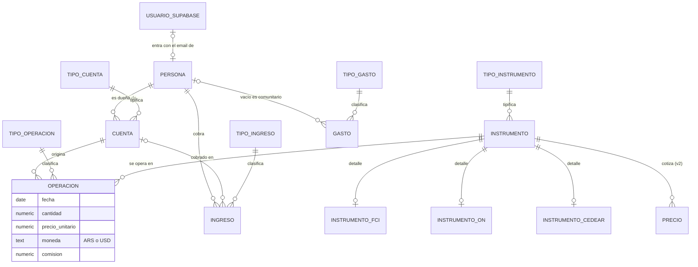

# Modelo de datos de LemonHouse

> Estado. Propuesta del 2026-10-25, armada sobre el DER dibujado a mano por Noelia y su revisión. Las columnas exactas, los tipos y las restricciones se cerraron el 2026-10-26 en el plan de la v1, `docs/plans/2026-10-26-lemonhouse-v1.md`.

## Decisiones que dan forma al modelo

- **Una cuenta pertenece a una sola persona.** Es el caso real del grupo que la usa primero, donde cada cuenta bancaria o comitente está a nombre de una persona. La persona de una operación sale de su cuenta, así que la operación no apunta a la persona.
- **El login lo maneja Supabase, con Google.** La persona tiene un email opcional, que es su invitación. Solo entra a la app quien tiene su email cargado en una persona. Se usa el email y no el usuario de Supabase porque la invitación tiene que existir antes del primer ingreso, cuando ese usuario todavía no existe. Se descartaron tablas propias de login y de accesos, porque Supabase ya guarda las credenciales y registra los ingresos.
- **Instrumento general más detalle donde hace falta.** Todas las operaciones apuntan a una sola tabla de instrumentos, sin importar el tipo. Los tipos con campos propios (FCI, ON, CEDEAR) suman una tabla de detalle 1 a 1. Se descartaron una tabla por tipo sin la general, porque la operación necesitaría una clave foránea por tipo, y un campo jsonb para los atributos, porque no se puede validar ni relacionar.
- **La posición no se guarda, se calcula.** Lo que se tiene hoy de cada instrumento en cada cuenta sale de sumar compras y restar ventas. Guardarlo aparte permitiría que un día no coincida con las operaciones.
- **Las categorías son tablas.** Tipo de cuenta, de instrumento, de operación, de gasto y de ingreso, para que cada grupo arme las suyas. Los tipos de instrumento y de operación llevan además un código fijo, porque la app los usa en sus reglas. La ON pide vencimiento, la compra suma y la venta resta.

## Diagrama

## Entidades

| Entidad | Qué guarda | Campos principales |
|---|---|---|
| `persona` | Cada integrante del grupo | nombre, email (opcional, es la invitación) |
| `tipo_cuenta` | Catálogo de tipos de cuenta | nombre (banco, comitente nacional, comitente del exterior, billetera) |
| `cuenta` | Cuenta bancaria o comitente de una persona | persona, tipo de cuenta, entidad (Santander, IOL, Schwab), nombre |
| `tipo_instrumento` | Catálogo de instrumentos | código, nombre (Acción, CEDEAR, ON, ETF, FCI, Cripto) y cada cuánto cotiza |
| `instrumento` | La especie exacta que se opera | tipo, ticker con sufijo (AAPL, AAPLD, AAPLC), nombre, moneda, vencimiento (solo la ON) |
| `instrumento_fci` | Detalle de un FCI | código CAFCI, la clave para pedir el precio a la FastAPI |
| `instrumento_on` | Detalle de una ON | emisor, valor nominal residual |
| `instrumento_cedear` | Detalle de un CEDEAR | ratio, subyacente |
| `tipo_operacion` | Catálogo de operaciones | nombre (COMPRA, VENTA, y después renta, dividendo, amortización) |
| `operacion` | Cada compra o venta | cuenta, instrumento, tipo, fecha, cantidad, precio unitario, moneda (la del instrumento), comisión |
| `posicion` (vista) | Lo que se tiene hoy | se calcula de `operacion` por cuenta e instrumento |
| `tipo_gasto` y `gasto` | Salidas de plata | persona (opcional, vacía es comunitario), tipo, fecha, monto, moneda, descripción |
| `tipo_ingreso` e `ingreso` | Entradas de plata | persona, cuenta (opcional), tipo, fecha, monto, moneda, descripción |
| `precio` (v2) | Valor de un instrumento en un momento | instrumento, fecha y hora, precio, moneda, fuente |

Todas las tablas llevan fecha de alta y quién cargó la fila.

## Reglas que hace cumplir la base

Las reglas del PRD no se confían a la interfaz. La base las impide.

- **Moneda solo ARS o USD**, en operaciones, gastos, ingresos y precios.
- **Una operación no existe sin cuenta ni instrumento.**
- **La moneda de una operación es la de su instrumento.** Una clave foránea doble (instrumento y moneda) lo impone, y además impide cambiarle la moneda a un instrumento con operaciones.
- **Ninguna venta deja la posición en negativo**, ni al cargarla ni al editar o borrar una compra anterior.
- **Una ON no existe sin vencimiento.** Al vencer deja de cotizar, y sin la fecha su último precio quedaría congelado como si siguiera vigente.
- **Un gasto sin persona es comunitario.** Es el valor por defecto y no hace falta elegir nada al cargarlo.

## Trampas de dominio

- **El ticker define la moneda.** AAPL cotiza en pesos, AAPLD en dólar MEP y AAPLC en dólar cable. Las ONs siguen el mismo patrón (O en pesos, D en MEP, C en cable).
- **Las ONs cotizan cada 100 de valor nominal.** El valor de una posición sería cantidad × precio / 100. Es la convención que se ve en los datos y la que adopta la v1. Si hiciera falta corregirla, es un dato de `tipo_instrumento`, no código.
- **El valor de un FCI que da la CAFCI es por mil cuotapartes.** El valor de una posición es cantidad × valor / 1000. En la v1 el valor se carga por cuotaparte, y la conversión desde el valor de la CAFCI llega con los precios de la v2.

## Cómo se escala a cuentas compartidas

Hoy no hay cuentas compartidas. Si aparecen, son dos cambios acotados.
1. `cuenta.persona_id` se reemplaza por una tabla `cuenta_persona` que relaciona muchas personas con muchas cuentas.
2. `operacion` pasa a guardar qué persona invirtió, con una clave foránea compuesta contra `cuenta_persona` para que solo pueda ser alguien de esa cuenta.

Las operaciones ya cargadas se migran asignándolas al dueño actual de su cuenta.

## Cerrado en el plan de la v1

- **Columnas, tipos y restricciones.** En la sección 5 del plan.
- **Moneda de la operación.** Se guarda en la operación, y la base exige que sea la del instrumento.
- **Precio promedio.** Se calcula en la vista `posicion` con un agregado SQL. Cada compra suma su monto más su comisión, y cada venta descuenta al promedio vigente (C12 de la spec de la v1).
- **Vencimiento de la ON.** Va en `instrumento` y no en `instrumento_on`, para que "una ON sin vencimiento no existe" sea una restricción de una sola tabla.
- **Persona e invitación.** La persona lleva el email en lugar de apuntar al usuario de Supabase.
